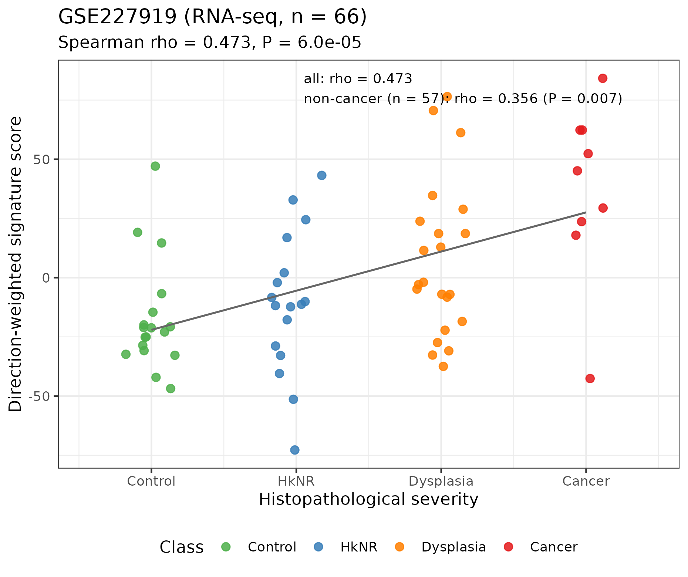
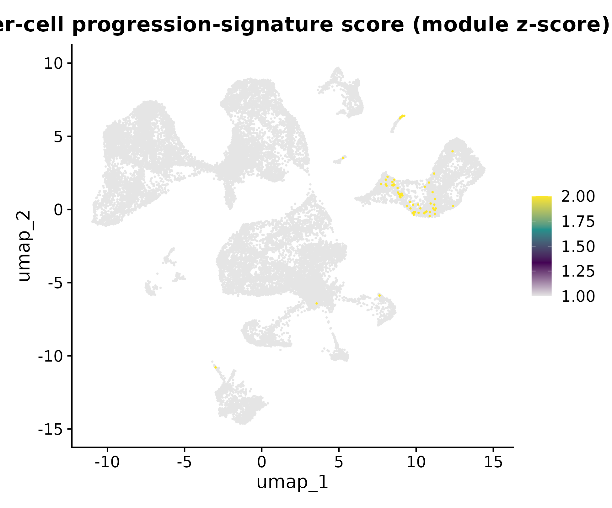
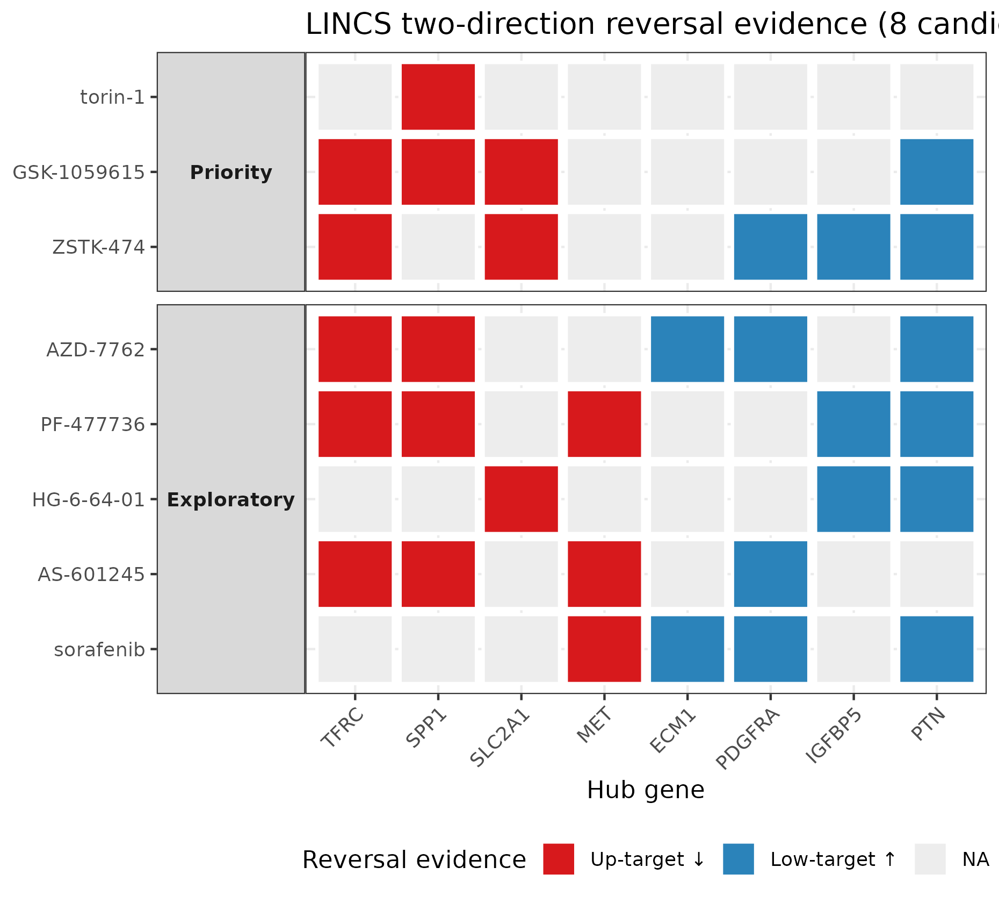
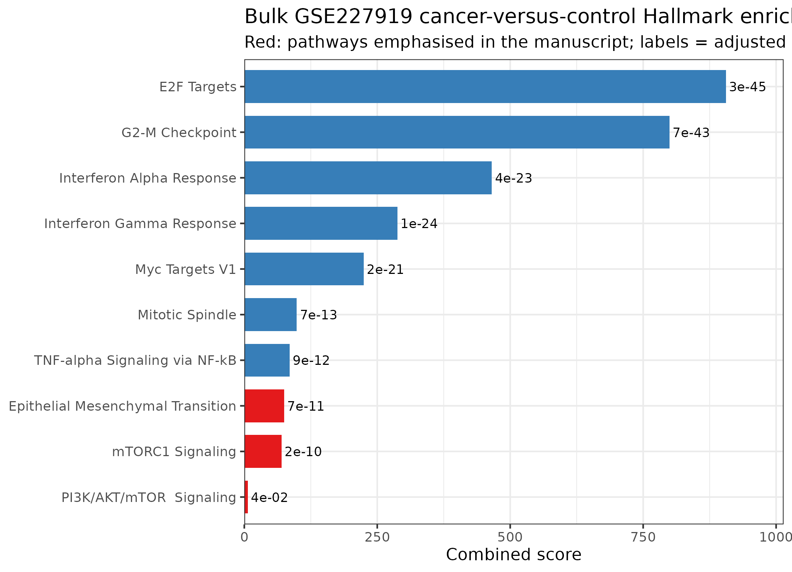
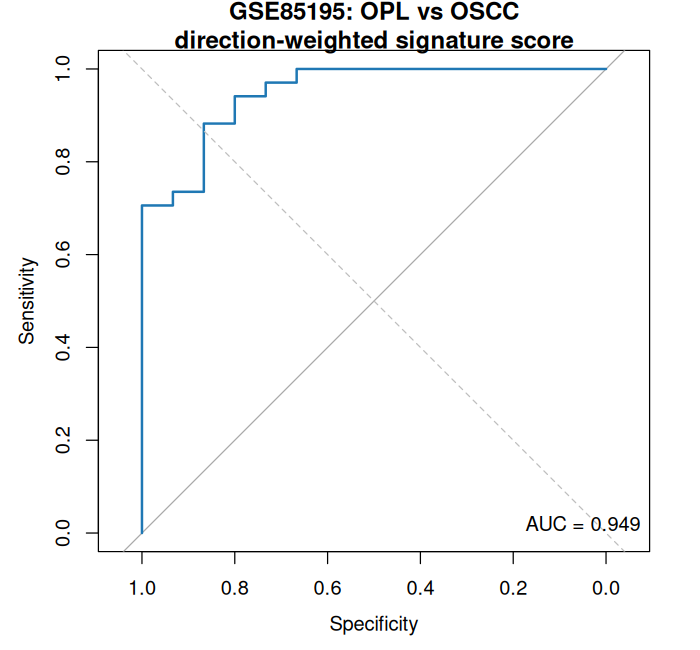
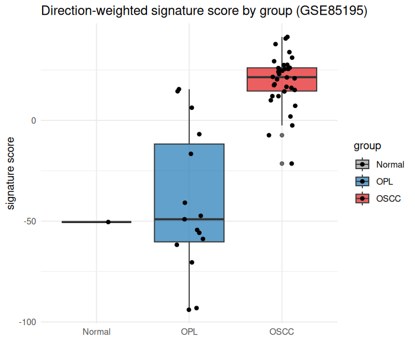

# A validated transcriptomic signature of malignant progression in oral leukoplakia and proliferative verrucous leukoplakia: independent replication, single-cell mapping, and in silico drug repositioning

**Author(s):** [Author Name(s)]  
**Affiliation(s):** [Department, Institution]  
**Corresponding Author:** [Name, email]  
**Date:** 2026-08-04 (draft v2)

---

## Abstract

**Objective.** Oral leukoplakia (OL) and proliferative verrucous leukoplakia (PVL) carry unpredictable malignant-transformation risk. We derived and independently validated a transcriptomic progression signature across microarray, RNA-seq, and single-cell data, then prioritised repositionable chemopreventive drugs.

**Materials and Methods.** The 101-gene progression signature was derived from GSE26549 (Affymetrix; 86 OL; limma, adj. *P* < 0.05, \|logFC\| > 0.5). Independent validation on GSE227919 (RNA-seq; 66 samples) used a direction-weighted, within-cohort z-score blind to validation labels. Single-cell localisation used GSE196296 (3 PVL lesions; ~28,000 cells; Seurat v5), with eta-squared as the primary effect-size measure. Drug repositioning queried Enrichr LINCS L1000 libraries via two-direction (reversal) intersection.

**Results.** The signature replicated as a continuous severity gradient (ρ = 0.473, *P* = 5.99 × 10⁻⁵; ρ = 0.356, *P* = 0.007 after excluding cancer), confirming the signal tracks premalignant severity. Internal five-fold cross-validation AUC = 1.0, reported as optimistic owing to gene-selection circularity. At single-cell resolution, the signature showed no lesion-level gradient (η² = 0.006) but was enriched in specific cell states. Eight reversal candidates were identified and stratified, with PI3K/mTOR inhibitors (torin-1, GSK-1059615, ZSTK-474) prioritised by an existing clinical precedent. Bulk cancer-versus-control enrichment implicated mTORC1, PI3K-AKT-mTOR and EMT pathways. In a second independent Agilent microarray cohort (GSE85195; 15 oral leukoplakia, 34 OSCC), the same direction-weighted score discriminated pre-malignant from malignant tissue (AUC 0.95, 95% CI 0.89–1.0) and tracked the ordinal severity axis (ρ = 0.72), confirming the signature generalises across platform and population as a marker of the premalignant-to-malignant transition.

**Conclusions.** The progression signature is independently validated on RNA-seq and localised to immune-suppressive and metabolically rewired cell states. Eight repositionable compounds are proposed; PI3K/mTOR inhibition warrants prospective chemoprevention evaluation.

**Keywords:** oral leukoplakia; proliferative verrucous leukoplakia; transcriptomic signature; malignant transformation; single-cell RNA-seq; LINCS; drug repurposing

---

## 1. Introduction

### 1.1 Oral potentially malignant disorders and the transformation problem

Oral leukoplakia (OL) and its aggressive variant proliferative verrucous leukoplakia (PVL) are oral potentially malignant disorders in which a portion of lesions progress to oral squamous cell carcinoma (OSCC) over years to decades. Reported cumulative malignant transformation rates span 0.13%–34% across cohorts and follow-up lengths [20,21], so the central clinical challenge is identifying which lesions will transform. Current histopathologic grading of epithelial dysplasia is subjective and only weakly predictive, and surgical resection of OL has not been shown to reduce OSCC incidence. Molecular biomarkers, notably loss of heterozygosity (LOH) at 3p/9p and TP53 alteration, are the most robust traditional risk markers [22], yet they leave substantial uncertainty for individualised prevention.

### 1.2 Prior transcriptomic signatures and their limits

Gene-expression profiling has repeatedly been proposed to improve risk stratification. Saintigny et al. [1] derived a 29-transcript predictive model from the GSE26549 microarray cohort that anticipated oral cancer development with approximately 8% prediction error, and separately identified 2,182 progression-associated transcripts by univariate Cox modelling. More recently, Foy et al. [2] used the same GSE26549 discovery set to describe two OPL gene-expression subtypes, immunological and classical, validated across three small independent datasets, with divergent immune infiltration and LOH associations. These efforts established that OL/PVL harbour reproducible transcriptomic structure, but two gaps remain. First, the discovery and the best-known validation both lean on microarray cohorts of modest size; independent confirmation on a modern RNA-seq platform with a graded severity axis is still lacking. Second, the biological and cellular meaning of a progression signature, and its tractability as a prevention target, are incompletely resolved.

### 1.3 Aims and research questions

We reasoned that a progression signature should be re-derived from the same discovery cohort, then validated on an independent RNA-seq cohort using a scoring scheme that is intrinsically platform-agnostic, mapped onto the cellular architecture of a single PVL lesion traversed by a pathological continuum, and finally translated into candidate prevention drugs. The study addresses three questions:

1. **RQ1 (external validity).** Does a GSE26549-derived progression signature generalise to an independent RNA-seq cohort as a graded severity signal?
2. **RQ2 (cellular localisation).** At single-cell resolution, which cell states carry the progression signature within a PVL lesion?
3. **RQ3 (translatability).** Which approved or investigational compounds reverse the progression signature and therefore merit chemoprevention evaluation?

This study is a re-analysis of public datasets; it derives no new measurements. Its contribution is the integration of cross-platform validation, single-cell localisation, and direction-aware in silico repositioning around one signature, together with explicit reporting of the optimism and limitations of each step.

---

## 2. Materials and Methods

### 2.1 Data sources

Three public Gene Expression Omnibus (GEO) datasets were used. **GSE26549** (Affymetrix Human Gene 1.0 ST, GPL6244) comprises 86 OL with progression outcome metadata (35 cancer development, 51 no cancer); baseline biopsy subsets (62 cases; 21 progressing, 41 non-progressing) were used for signature derivation. **GSE227919** (RNA-seq, GPL18573) comprises 66 samples across an ordinal severity axis: Control (n = 18), hyperplasia with no reported risk (HkNR, n = 17), dysplasia (n = 22), and cancer (n = 9); expression values are raw TPM-scale counts (non-logged). **GSE196296** provides single-cell RNA-seq (10x Genomics) of three tissue blocks sampled along one PVL lesion (annotated KUS, corrugated, and bulky hyperkeratosis), totalling approximately 28,000 cells. **GSE85195** (Agilent Whole Human Genome Microarray 4×44K, GPL6480) comprises 50 samples from the gingivobuccal complex: 15 oral leukoplakia (OPL), 34 early-stage OSCC, and 1 normal control [23]. All data were downloaded from GEO; dataset accessions and processing dates are listed in the Data Availability Statement.

### 2.2 Signature derivation

For GSE26549, probe-level summarisation was mapped to gene symbols using the platform annotation; genes were taken as the unit of analysis. Differential expression between progressing and non-progressing baseline biopsies was computed with limma (empirical Bayes moderated t-test). A progression signature was defined as genes with adj. *P* < 0.05 and |logFC| > 0.5, yielding 101 genes. We deliberately adopted a permissive threshold to retain biological signal for signature scoring, accepting that the set is discovery-oriented rather than a parsimonious classifier.

### 2.3 Cross-platform validation: direction-weighted z-score score

To validate the signature on RNA-seq without transferring raw coefficients across platforms (which fails under distribution shift), we used a direction-weighted, within-cohort standardised score. For each validation cohort, every signature gene was z-scored within that cohort (mean 0, SD 1). The score for sample *i* was Σg wg · zig, where wg = sign(logFCg) · |logFCg| from the discovery cohort, and the score borrows only the direction and relative magnitude of each gene's discovery effect. This construction is blind to GSE227919 phenotype labels. We tested the score against the ordinal severity axis (0 = Control, 1 = HkNR, 2 = dysplasia, 3 = cancer) by Spearman correlation. To exclude the concern that the gradient is driven merely by the presence of cancer-label samples, we additionally computed the correlation after excluding cancer cases (Control/HkNR/dysplasia only). Direction-aware single-sample scoring follows the same family as singscore methods, which are stable across microarray and RNA-seq [11,12]. The identical, label-blind procedure was applied to GSE85195 to test cross-sectional discrimination between oral leukoplakia and OSCC; because that cohort is cross-sectional (prevalent lesions without transformation follow-up), this constitutes a state-discrimination test of the pre-malignant-to-malignant axis, not a prospective prediction of individual transformation.

### 2.4 LASSO internal validation and its optimism

A LASSO logistic regression was fit on the discovery cohort using the 101-gene signature to separate progressors from non-progressors, with a five-fold cross-validation whose fold assignments were fixed explicitly (not regenerated internally) so that the procedure is reproducible. We report the cross-validated area under the curve but explicitly label it an optimistic discovery-phase estimate, because feature selection (the 101 genes) and model fitting share the same data. This circularity is the recognised source of inflated internal performance in high-dimensional signatures [13,14]. As a negative control for platform portability, we also transferred the discovery LASSO coefficients directly onto GSE227919 and report that classification, which is expected to fail under platform non-comparability.

### 2.5 Single-cell analysis and effect-size reporting

GSE196296 counts were processed with Seurat v5: standard quality control, log-normalisation, variable-feature selection, PCA, graph-based clustering (24 clusters), and uniform manifold approximation projection. Cell-type annotation used canonical marker genes. The progression signature was summarised per cell as a module score. To test whether the signature differed across the three lesion blocks, we used Kruskal–Wallis followed by eta-squared (η²) as the effect-size measure. Because the cohort exceeds 28,000 cells, p-values collapse to trivial significance; we therefore report η² as the primary quantity and interpret η² < 0.01 as below the small-effect threshold (η² ≈ 0.01 small, 0.06 medium, 0.14 large per Cohen, 1988), rather than relying on p-values [17,18].

### 2.6 In silico drug repositioning

The 101-gene signature was split into progression-up and progression-down gene sets. Using Enrichr [16], we queried the LINCS L1000 directional libraries (chemical perturbation up and down) [8,9] for compounds whose transcriptional effect reverses the signature: a reversal candidate must significantly down-regulate progression-UP genes and up-regulate progression-DOWN genes (two-direction intersection, adj. *P* < 0.05 in both directions). Single-direction queries were retained only as a noise benchmark. Candidates were stratified by target class [10,19], and PI3K/mTOR inhibitors were flagged as priority given an existing clinical precedent in oral premalignant lesions.

### 2.7 Pathway deconvolution

The 101-gene signature was tested for enrichment against Hallmark, GO, KEGG, ChEA (transcription-factor targets) and ENCODE libraries via Enrichr. Separately, to anchor mechanism in a comparable contrast, we performed pathway enrichment on the bulk GSE227919 cancer-versus-control differential expression (adj. *P* < 0.05 and |logFC| > 1; 2,986 up- and 368 down-regulated genes) and report those results as the bulk-level mechanistic context. We keep the signature-level and bulk-level enrichments distinct, because they answer different questions.

### 2.8 Probe-collapse sensitivity

GSE26549 probes were collapsed to genes by both maximum and mean probe intensity per gene; differential expression and the downstream validation gradient were recomputed under each rule to assess sensitivity to probe summarisation.

### 2.9 Statistics and reproducibility

Spearman and Kruskal–Wallis tests, eta-squared, and LASSO were computed in R 4.3.3 (limma, glmnet, Seurat, enrichR). Session information and dataset versions accompany the analysis scripts in the project repository. No new biological samples were generated.

---

## 3. Results

### 3.1 Discovery signature

Differential expression in GSE26549 baseline biopsies (21 progressing versus 41 non-progressing) yielded 101 signature genes at adj. *P* < 0.05 and |logFC| > 0.5. Of these, 86 were represented in the GSE227919 cohort, of which ~91% were directionally concordant. The signature includes progression-associated genes such as iron metabolism (TFRC) and ECM/immune reprogramming (SPP1), consistent with a malignant-preneoplastic expression programme.

### 3.2 External validation as a severity gradient

In the independent RNA-seq cohort GSE227919, the direction-weighted z-score signature tracked the ordinal severity axis with Spearman ρ = 0.473 (*P* = 5.99 × 10⁻⁵) across all 66 samples (Figure 1A). Excluding the nine cancer cases, the gradient remained significant in the premalignant range (Control/HkNR/dysplasia, n = 57; ρ = 0.356, *P* = 0.007), indicating the signal reflects graded premalignant severity rather than a cancer-versus-non-cancer split. Internal five-fold cross-validation on the discovery cohort gave an AUC of 1.0, which we report as an optimistic discovery-phase estimate attributable to gene-selection circularity. Directly transferring the discovery LASSO coefficients to GSE227919 yielded a markedly lower AUC (0.435), illustrating the expected failure of naive cross-platform coefficient transfer and motivating the direction-weighted score. In the smaller progressing-versus-stable subset (n = 27) the score did not separate groups (AUC 0.55, *P* = 0.71), consistent with limited power for an endpoint-defined contrast.

### 3.3 Single-cell localisation

Across the three PVL lesion blocks (approximately 28,000 cells, 24 clusters), the ecosystem was keratinocyte-dominant with discernible T-cell infiltration, and the most advanced block (bulky hyperkeratosis) showed enrichment of Treg, plasma and mast-cell states, concordant with reported accumulating immune suppression in premalignant progression [3–6]. The progression signature, however, showed no lesion-level gradient: between-block η² = 0.006 (Kruskal–Wallis *P* = 1.13 × 10⁻¹¹, but η² below the small-effect threshold of 0.01) (Figure 1B). The signature was instead concentrated in specific cell states. Quantifying cluster-level localisation (per-cell direction-weighted score, cluster versus the remaining cells, Wilcoxon rank-sum with BH-FDR correction), the five clusters with the highest mean scores were 5, 13, 22, 23 and 15; each exceeded the rest with a medium-to-large ordinal effect size (Cliff's δ = 0.43–0.89; cluster 5 strongest: δ = 0.89, η² = 0.28) (Supplementary Figure S1). Because the dataset comprises 28,543 cells, all 24 clusters reached nominal FDR < 0.05, so we interpret the rank-ordered effect sizes rather than the significance test; the five clusters nonetheless represent the strongest signature concentrations. Four of the 20 LASSO-selected genes (QPCT, ECM1, S100A7A, RBP7) overlapped epithelial/keratinocyte cluster markers, providing a cell-level anchor for the risk model. Pseudobulk direction concordance with the bulk logFC was 67.8%.

### 3.4 In silico drug repositioning

A single-direction LINCS query returned 727 nominally significant compounds, whereas the two-direction reversal intersection narrowed to eight high-confidence candidates (Figure 2, Table 1): sorafenib (multi-kinase), torin-1 (mTOR), AZD-7762 and PF-477736 (CHK1), GSK-1059615 (PI3K/mTOR), ZSTK-474 (PI3K), HG-6-64-01 (HDAC) and AS-601245 (JNK). Hub progression-high genes (TFRC, SPP1) were consistently down-regulated and progression-low genes (ECM1, PDGFRA, IGFBP5, PTN) up-regulated across candidates. We stratified candidates into a priority tier (PI3K/mTOR: torin-1, GSK-1059615, ZSTK-474), supported by metformin's demonstrated histological response in oral premalignant lesions, and an exploratory tier (CHK1, HDAC, JNK, multi-kinase). Throughout, we use the term *transcriptome-matched candidate compounds* and make no causal reversal claim.

### 3.5 Pathway deconvolution

At the signature level, Enrichr returned a single significant Hallmark term (UV Response Down; adj. *P* = 0.023) and three GO terms (steroid/androgen catabolic metabolism; negative regulation of proteolysis), with no transcription-factor library reaching significance. This sparsity indicates the 101-gene set is not a tight, singly-interpretable module. By contrast, bulk GSE227919 cancer-versus-control enrichment was rich, implicating mTORC1, PI3K-AKT-mTOR and EMT Hallmark pathways (alongside E2F, G2M and interferon responses). We present the latter as the bulk-level mechanistic context that motivates the PI3K/mTOR-priority drug tier (Figure 3, Table 2), while being explicit that it is a different contrast from the signature-level enrichment.

### 3.6 Probe-collapse robustness

Collapsing GSE26549 probes by maximum versus mean intensity changed the signature set minimally (101 versus 102 genes; Jaccard 0.971; logFC Spearman 0.997) and did not alter the external gradient (ρ = 0.473 versus 0.47). The signature is therefore insensitive to probe-summarisation choice.

### 3.7 Independent cross-sectional corroboration in a second microarray cohort

To test whether the signature generalises beyond the RNA-seq platform and beyond the original population, we applied the identical direction-weighted z-score (fixed discovery weights; 83 of 101 signature genes mapped, 82.2%) to GSE85195, an independent Agilent microarray cohort from the gingivobuccal complex. In this cohort the signature strongly separated pre-malignant from malignant tissue: oral leukoplakia (OPL, n = 15) versus OSCC (n = 34) discrimination gave an AUC of 0.949 (95% CI 0.891–1.0; Figure 4A), and the score tracked the ordinal pre-malignant-to-malignant axis (OPL < OSCC) with Spearman ρ = 0.717 (*P* = 6.8 × 10⁻⁹; Figure 4B). Mean score was negative in OPL (−40.8) and positive in OSCC (+19.5). Because GSE85195 is cross-sectional — the OPL samples are prevalent leukoplakia without transformation follow-up — this result establishes that the signature discriminates the malignant from the pre-malignant *state* and tracks the severity axis across an independent platform and population; it does not by itself predict which individual leukoplakia will transform. The single normal control (n = 1) precluded a normal-group comparison.

---

## 4. Discussion

### 4.1 A cross-platform validated progression signature

The principal finding is that a GSE26549-derived progression signature generalises to an independent RNA-seq cohort as a graded severity signal (ρ = 0.47), and that this signal persists after removing cancer cases (ρ = 0.36). The direction-weighted z-score score is central to this result: by borrowing only each gene's discovery direction and recomputing standardisation within each cohort, it avoids the distribution shift that defeats raw coefficient transfer (observed AUC 0.435). The internal CV-AUC of 1.0 is reported candidly as optimistic; we do not present it as a generalisation estimate. The signal is further corroborated in an independent Agilent microarray cohort from a different anatomical site and population (GSE85195), where the same score discriminates oral leukoplakia from OSCC (AUC 0.95) and tracks the ordinal severity axis (ρ = 0.72), showing the signature is not an RNA-seq-specific or population-specific artefact.

### 4.2 Relation to prior signatures

Because the signature is derived from the same GSE26549 cohort that produced Saintigny's [1] 29-transcript model and Foy's [2] immunological/classical subtypes, it cannot claim independence from those works; rather, it is a replication and refinement using a continuous, direction-weighted score and an independent RNA-seq confirmation. Symbol-level overlap with Saintigny's sparse 29-transcript model is zero (Jaccard 0.0), which is expected because that model is an optimised classifier dominated by non-coding and Ensembl transcripts, whereas ours is a differential-expression set. The genuine independence claim rests on GSE227919, not on GSE26549.

### 4.3 Cellular architecture and the immune-metabolic axis

Single-cell mapping reframes the signature's meaning. It does not track the pathological continuum across lesion blocks (η² = 0.006, below the small-effect threshold of 0.01), arguing against a simple linear escalation along the KUS-to-bulky-hyperkeratosis axis. Instead it is concentrated in specific cell states enriched for immune-suppressive and epithelial-metabolic programmes. This is consistent with Zhong, Sun and Wang [3,5,6], who described accumulating immune suppression and epithelial remodelling in OL/PVL progression. We therefore interpret the bulk signature as a cohort-level property of progression biology, locally expressed in immune-metabolically rewired cell states, rather than a uniform field across one lesion.

### 4.4 Drug candidates and clinical precedent

Eight transcriptome-matched candidates emerged from a stringent two-direction reversal test. The PI3K/mTOR tier is prioritised because Gutkind et al. [7] showed that metformin inhibition of mTOR signalling produced histological response in 60% of evaluated oral premalignant lesions, with pS6 reduction tracking response. That human oral-lesion precedent, not merely cell-line logic, justifies advancing PI3K/mTOR inhibitors (torin-1, GSK-1059615, ZSTK-474) ahead of the exploratory CHK1/HDAC/JNK tier. We stress that LINCS perturbations derive from cancer cell lines, so three assumptions separate them from oral epithelia (cell-line approximates keratinocyte, transcriptional reversal approximates phenotypic reversal, in vitro approximates in vivo); the candidates are hypotheses for prospective testing, not validated preventives.

### 4.5 Limitations

Several limits bound the conclusions. The discovery and best-known prior signatures share GSE26549, so discovery and replication-within-cohort are entangled; the independent evidence now includes GSE227919 (RNA-seq severity gradient) and GSE85195 (microarray cross-sectional discrimination), which together show the signature generalises across platform and population. However, both are cross-sectional, so they establish that the signature tracks the pre-malignant-to-malignant axis rather than predicting individual transformation; a prospective transformation-outcome cohort remains the key unmet need. External validation power is modest (GSE227919 n = 66; progression-defined subsets smaller still), so the gradient, while significant, is a medium effect. GSE85195 contributed only one normal control, precluding a normal-group comparison and leaving the pre-malignant-to-normal separation untested. Single-cell analysis used one PVL lesion without outcome labels, so cellular findings are descriptive. LINCS candidates lack in vitro or in vivo validation and are cell-line derived. Enrichment used Enrichr against L1000, whose cross-dataset reproducibility is limited [15]; the consensus-signature library did not auto-match our compound identifiers, so candidate consolidation across libraries is incomplete. Finally, no batch-integration was performed across platforms; the direction-weighted z-score score substitutes for probabilistic matching.

### 4.6 Conclusion

A progression signature originally described in the GSE26549 microarray cohort is independently validated on RNA-seq as a graded severity signal and is localised to immune-suppressive and metabolically rewired cell states within PVL. Eight transcriptome-matched compounds are proposed as chemoprevention candidates, with PI3K/mTOR inhibition the most clinically supported. The work illustrates a transparent, platform-agnostic validation path for oral potentially malignant disorder signatures and yields concrete, testable prevention hypotheses.

---

## Data Availability Statement

All input data are public and were downloaded from the Gene Expression Omnibus (https://www.ncbi.nlm.nih.gov/geo/): GSE26549, GSE227919, GSE196296 and GSE85195. The complete 101-gene signature, per-sample direction-weighted scores for the GSE227919 and GSE85195 validation cohorts, single-cell cluster-level statistics, and all analysis scripts with session information (R 4.3.3, package versions) are deposited in a public Zenodo repository at https://doi.org/10.5281/zenodo.21823584. The version-controlled analysis code is also available on GitHub at https://github.com/tiduslrg. Dataset accessions and download dates, the file inventory, and the reproduction procedure are listed in the deposit README.

## Ethics Statement

This study is a secondary analysis of de-identified public datasets with no individual-level identifiers and no new subject recruitment; institutional review board approval was not required.

## Author Contributions (CRediT)

[To be completed by the author.] Conceptualisation, [ ]; Data curation, [ ]; Formal analysis, [ ]; Methodology, [ ]; Writing (original draft), [ ]; Writing (review and editing), [ ]; Supervision, [ ].

## Conflict of Interest Statement

The authors declare no competing interests.

## Funding

This research received no specific grant from any funding agency.

## AI Disclosure

This manuscript was prepared with the assistance of an AI-powered academic writing tool. All analyses, results, and interpretations were designed and verified by the author(s), who take full responsibility for the content.

---

## References

1. Saintigny P, Zhang L, Fan YH, et al. Gene expression profiling predicts the development of oral cancer. *Cancer Prev Res (Phila).* 2011;4(2):218-229. doi:10.1158/1940-6207.CAPR-10-0155
2. Foy JP, Bertolus C, Ortiz-Cuaran S, et al. Immunological and classical subtypes of oral premalignant lesions. *Oncoimmunology.* 2018;7(12):e1496880. doi:10.1080/2162402X.2018.1496880
3. Zhong L, Wang F, Liu D, et al. Single-cell transcriptomics dissects premalignant progression in proliferative verrucous leukoplakia. *Oral Dis.* 2024;30(2):172-186. doi:10.1111/odi.14347
4. Puram SV, Tirosh I, Parikh AS, et al. Single-cell transcriptomic analysis of primary and metastatic tumor ecosystems in head and neck cancer. *Cell.* 2017;171(7):1611-1624.e24. doi:10.1016/j.cell.2017.10.044
5. Sun L, Kang X, Wang C, et al. Single-cell and spatial dissection of precancerous lesions underlying the initiation of oral squamous cell carcinoma. *Cell Discov.* 2023;9(1):28. doi:10.1038/s41421-023-00532-4
6. Wang H, Guan Z, Zheng L. Single-cell RNA sequencing explores the evolution of the ecosystem from leukoplakia to HNSCC. *Sci Rep.* 2024;14(1):8097. doi:10.1038/s41598-024-58978-9
7. Gutkind JS, Molinolo AA, Wu X, et al. Inhibition of mTOR signaling and clinical activity of metformin in oral premalignant lesions. *JCI Insight.* 2021;6(17):e147096. doi:10.1172/jci.insight.147096
8. Subramanian A, Narayan R, Corsello SM, et al. A Next Generation Connectivity Map: L1000 platform and the first 1,000,000 profiles. *Cell.* 2017;171(6):1437-1452.e17. doi:10.1016/j.cell.2017.10.049
9. Lamb J, Crawford ED, Peck D, et al. The Connectivity Map: using gene-expression signatures to connect small molecules, genes, and disease. *Science.* 2006;313(5795):1929-1935. doi:10.1126/science.1132939
10. Huang K, Lalagkas PN, Sultan B, et al. Exploiting similarity in drug molecular effects for drug repurposing. *Hum Genomics.* 2025;19(1):110. doi:10.1186/s40246-025-00808-8
11. Foroutan M, Bhuva DD, Lyu R, et al. Single sample scoring of molecular phenotypes. *BMC Bioinformatics.* 2018;19(1):404. doi:10.1186/s12859-018-2435-4
12. Foltz SM, Greene CS, Taroni JN, et al. Cross-platform normalization enables machine learning model training on microarray and RNA-seq data simultaneously. *Commun Biol.* 2023;6(1):222. doi:10.1038/s42003-023-04588-6
13. Simon RM, Subramanian J, Li MC, Menezes S. Using cross-validation to evaluate predictive accuracy of survival risk classifiers based on high-dimensional data. *Brief Bioinform.* 2011;12(3):203-214. doi:10.1093/bib/bbr001
14. Ambroise C, McLachlan GJ. Selection bias in gene extraction on the basis of microarray gene-expression data. *Proc Natl Acad Sci U S A.* 2002;99(10):6562-6566. doi:10.1073/pnas.102102699
15. Lim N, Pavlidis P. Evaluation of connectivity map shows limited reproducibility in drug repositioning. *Sci Rep.* 2021;11(1):17624. doi:10.1038/s41598-021-97005-z
16. Kuleshov MV, Jones MR, Rouillard AD, et al. Enrichr: a comprehensive gene-set enrichment analysis web server. *Nucleic Acids Res.* 2016;44(W1):W90-W97. doi:10.1093/nar/gkw377
17. Wasserstein RL, Lazar NA. The ASA statement on p-values: context, process, and purpose. *Am Stat.* 2016;70(2):129-133. doi:10.1080/00031305.2016.1154108
18. Lakens D. Calculating and reporting effect sizes to facilitate cumulative science. *Front Psychol.* 2013;4:863. doi:10.3389/fpsyg.2013.00863
19. Iskar M, Zeller G, Blattmann P, et al. Characterization of drug-induced transcriptional modules: towards drug repositioning and functional understanding. *Mol Syst Biol.* 2013;9:MSB201320. doi:10.1038/msb.2013.20
20. Warnakulasuriya S, Johnson NW, van der Waal I. Nomenclature and classification of potentially malignant disorders of the oral mucosa. *J Oral Pathol Med.* 2007;36(10):575-580. doi:10.1111/j.1600-0714.2007.00582.x
21. Silverman S Jr, Gorsky M, Lozada F. Oral leukoplakia and malignant transformation. A follow-up study of 257 patients. *Cancer.* 1984;53(3):563-568. doi:10.1002/1097-0142(19840201)53:3<563::AID-CNCR2820530332>3.0.CO;2-F
22. Mao L, Lee JS, Fan YH, et al. Frequent microsatellite alterations at chromosomes 9p21 and 3p14 in oral premalignant lesions and their value in cancer risk assessment. *Nat Med.* 1996;2(6):682-685. doi:10.1038/nm0696-682
23. Bhosale PG, Cristea S, Ambatipudi S, Desai RS, Kumar A, Patil R, et al. Chromosomal alterations and gene expression changes associated with the progression of leukoplakia to advanced gingivobuccal cancer. *Transl Oncol.* 2017;10(3):396-409. doi:10.1016/j.tranon.2017.03.008

---

## Figure Legends

**Figure 1.** (A) Severity-gradient validation of the direction-weighted progression-signature score in the independent RNA-seq cohort GSE227919 (n = 66): score versus histopathological severity (0 = Control, 1 = HkNR, 2 = Dysplasia, 3 = Cancer); grey line, linear fit. Spearman ρ = 0.473 (P = 5.99 × 10⁻⁵) across all samples and ρ = 0.356 (P = 0.007) after excluding the nine cancer cases (n = 57). (B) Single-cell UMAP of GSE196296 (28,543 cells, three PVL lesion blocks) coloured by per-cell progression-signature module score (within-gene z-score); between-block η² = 0.006 (Kruskal–Wallis P = 1.13 × 10⁻¹¹) indicates no lesion-level gradient.

**Figure 2.** LINCS L1000 two-direction reversal evidence for the eight candidate compounds (Table 1). Red cells, progression-up hub genes (TFRC, SPP1, SLC2A1, MET) down-regulated by the compound; blue cells, progression-low hub genes (ECM1, PDGFRA, IGFBP5, PTN) up-regulated. Compounds are grouped by tier (priority PI3K/mTOR versus exploratory CHK1/HDAC/JNK/multi-kinase).

**Figure 3.** Bulk GSE227919 cancer-versus-control Hallmark enrichment (top ten significant terms, adjusted P < 0.05, ranked by combined score). Red bars denote pathways emphasised in the manuscript (mTORC1, PI3K-AKT-mTOR, EMT); labels show adjusted P-values.

**Figure 4.** Independent cross-sectional corroboration in the Agilent microarray cohort GSE85195 (gingivobuccal complex; 15 OPL, 34 OSCC, 1 normal), using the identical direction-weighted signature score (83/101 genes mapped). (A) ROC for OPL-versus-OSCC discrimination: AUC = 0.949 (95% CI 0.891–1.0). (B) Per-group boxplot of the signature score; the score is negative in OPL and positive in OSCC (ordinal OPL < OSCC Spearman ρ = 0.717, P = 6.8 × 10⁻⁹). This is a cross-sectional state-discrimination result, not a prospective transformation-prediction result.

**Supplementary Figure S1.** Per-cluster progression-signature score in GSE196296 (28,543 cells, 24 seurat clusters). Bars show the mean per-cell direction-weighted score of each cluster, ranked high to low; blue denotes clusters significant versus the remaining cells after BH-FDR correction (all clusters reach FDR < 0.05 at this sample size, so effect size is the interpretive axis). Clusters 5, 13, 22, 23 and 15 carry the strongest concentrations (Cliff's δ = 0.43–0.89).

## Tables

**Table 1.** Eight LINCS L1000 two-direction reversal candidates. "Up-targets ↓" = number of progression-up signature genes significantly down-regulated by the compound; "Low-targets ↑" = number of progression-low genes significantly up-regulated; "Hub evidence" lists the hub genes (TFRC, SPP1, SLC2A1, MET / ECM1, PDGFRA, IGFBP5, PTN) with reversal evidence.

| Compound | Target class | Tier | Up-targets ↓ | Low-targets ↑ | Reversal score | Hub-gene evidence |
|---|---|---|---|---|---|---|
| ZSTK-474 | PI3K | Priority | 3 | 10 | 14.9 | TFRC, SLC2A1, PTN, PDGFRA, IGFBP5 |
| PF-477736 | CHK1 | Exploratory | 4 | 11 | 11.6 | TFRC, SPP1, MET, PTN, IGFBP5 |
| AZD-7762 | CHK1 | Exploratory | 3 | 14 | 11.5 | TFRC, SPP1, PDGFRA, PTN, ECM1 |
| HG-6-64-01 | HDAC | Exploratory | 3 | 11 | 10.7 | SLC2A1, PTN, IGFBP5 |
| GSK-1059615 | PI3K/mTOR | Priority | 3 | 8 | 9.0 | TFRC, SLC2A1, SPP1, PTN |
| AS-601245 | JNK | Exploratory | 3 | 5 | 6.5 | TFRC, SPP1, MET, PDGFRA |
| torin-1 | mTOR | Priority | 3 | 5 | 5.4 | SPP1 |
| sorafenib | Multi-kinase | Exploratory | 3 | 7 | 5.2 | MET, PDGFRA, PTN, ECM1 |

**Table 2.** Signature-level versus bulk-level pathway enrichment (honest sparsity at signature level).

| Enrichment layer | Hallmark (adj. P < 0.05) | GO | TF libraries (ChEA/ENCODE) | KEGG |
|---|---|---|---|---|
| Signature-level (101-gene, GSE26549) | 1 term: UV Response Down (adj. P = 0.023) | 3 terms: steroid/androgen metabolism; neg. reg. proteolysis | 0 | 0 |
| Bulk-level (GSE227919 cancer vs control, \|logFC\| > 1) | 24 terms; top: E2F, G2M, Interferon; mTORC1, PI3K-AKT-mTOR, EMT | n.r. | n.r. | n.r. |

**Table 3.** Independent cross-sectional corroboration in GSE85195 (Agilent microarray; direction-weighted score, fixed discovery weights).

| Cohort | Platform | Contrast | n (pre-mal. / mal.) | Mapped signature genes | AUC (95% CI) | Ordinal ρ (OPL < OSCC) |
|---|---|---|---|---|---|---|
| GSE85195 | Agilent 4×44K (GPL6480) | OPL vs OSCC | 15 / 34 | 83 / 101 (82.2%) | 0.949 (0.891–1.0) | 0.717 (P = 6.8 × 10⁻⁹) |

*Figure and table source files: `results/manuscript_figs/` (Fig1A_severity_gradient.png, Fig1B_umap_sigscore.png, Fig2_lincs_reversal.png, Fig3_bulk_hallmark.png, PVL9_ROC_OPL_vs_OSCC.png, PVL9_boxplot_score.png, Table1_reversal_candidates.csv, Table2_enrichment_summary.csv, PVL9_summary.csv, PVL9_GSE85195_scores.csv).*
